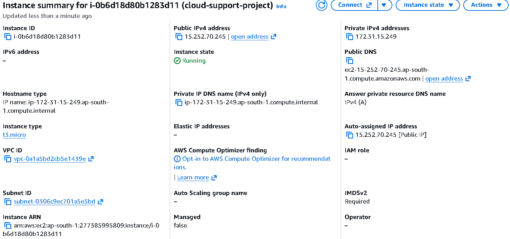
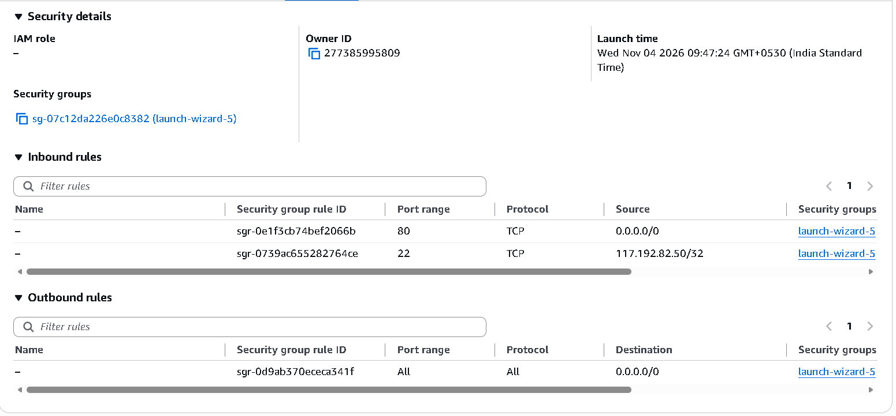
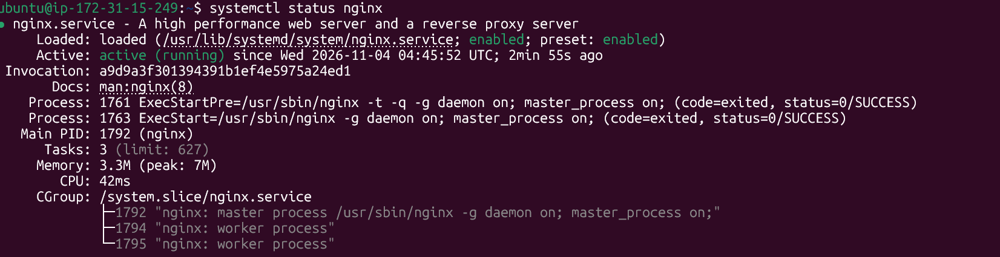
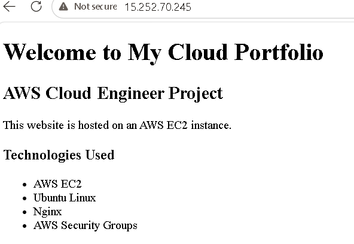
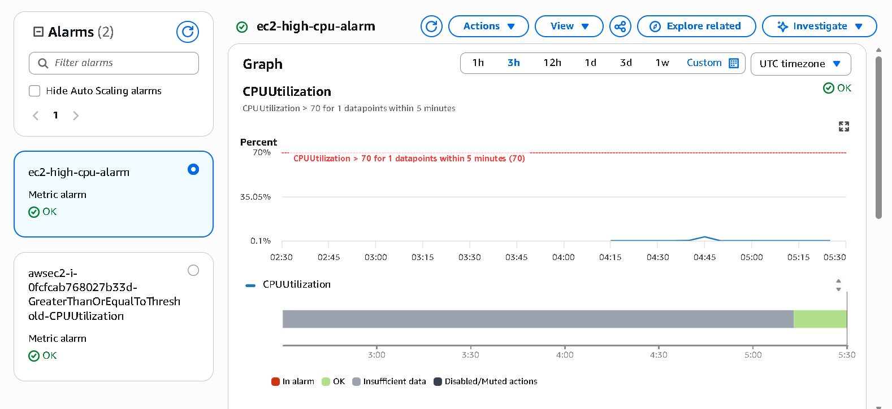

AWS EC2 Web Server Deployment and Monitoring

Project Overview

Deployed a portfolio website on an AWS EC2 Ubuntu instance using Nginx. Configured CloudWatch to monitor CPU utilization and created a CPU threshold alarm.

Technologies Used

- AWS EC2
- Ubuntu Linux
- AWS Security Groups
- SSH
- Nginx
- AWS CloudWatch
- GitHub

Architecture

Internet → Security Group → EC2 Ubuntu → Nginx → Portfolio Website

CloudWatch monitors EC2 CPU utilization.

Implementation

1. Launched an Ubuntu EC2 instance in AWS Mumbai region.
2. Created a key pair for SSH access.
3. Configured Security Groups for SSH (22) and HTTP (80).
4. Connected to Ubuntu using SSH.
5. Installed and configured Nginx.
6. Deployed a portfolio webpage.
7. Verified website accessibility using the EC2 public IP.
8. Created a CloudWatch CPU utilization alarm with a 70% threshold and 5-minute period.

Linux Commands Practised

sudo apt update
sudo apt install nginx -y
sudo systemctl start nginx
sudo systemctl enable nginx
sudo systemctl status nginx
sudo systemctl stop nginx
sudo journalctl -u nginx -n 20
df -h
free -h

Monitoring

- Metric: CPUUtilization
- Statistic: Average
- Period: 5 minutes
- Threshold: Greater than 70%
- Alarm: EC2-High-CPU-Alarm

Troubleshooting

Simulated an Nginx service failure by stopping the service, inspected its status and logs, and restored the service.

Skills Demonstrated

- AWS EC2
- Linux administration
- SSH connectivity
- Security Group configuration
- Nginx management
- CloudWatch monitoring
- Basic troubleshooting

Future Improvements

- Configure HTTPS.
- Configure and verify SNS email notifications.
- Collect Nginx logs using CloudWatch Logs.
- Automate infrastructure using Terraform.

- ## Project Screenshots

### EC2 Instance

### Security Group

### Nginx Web Server

### Deployed Portfolio

### CloudWatch Alarm

